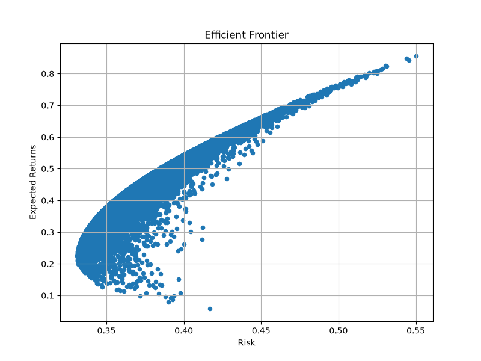
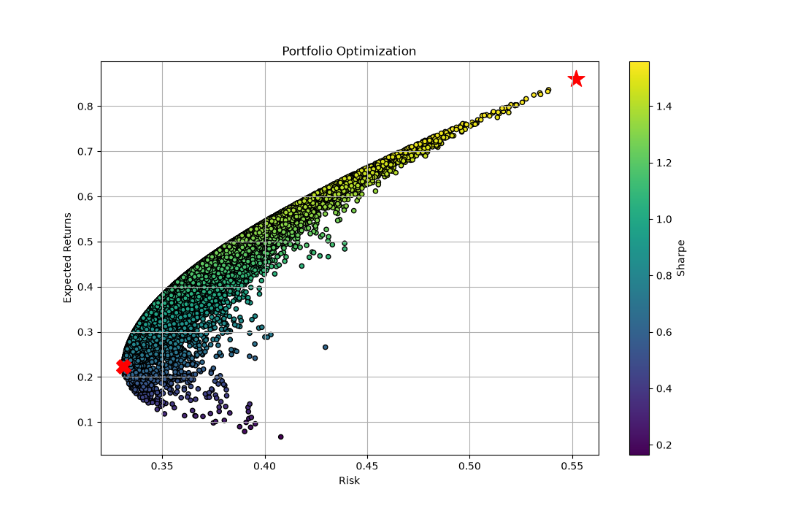
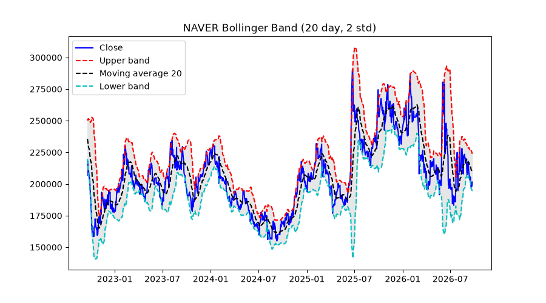
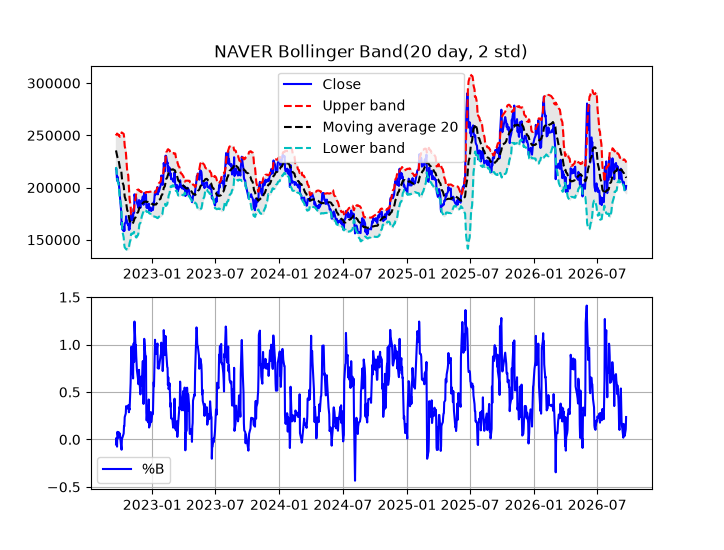
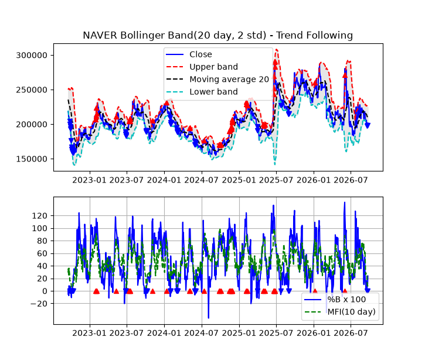
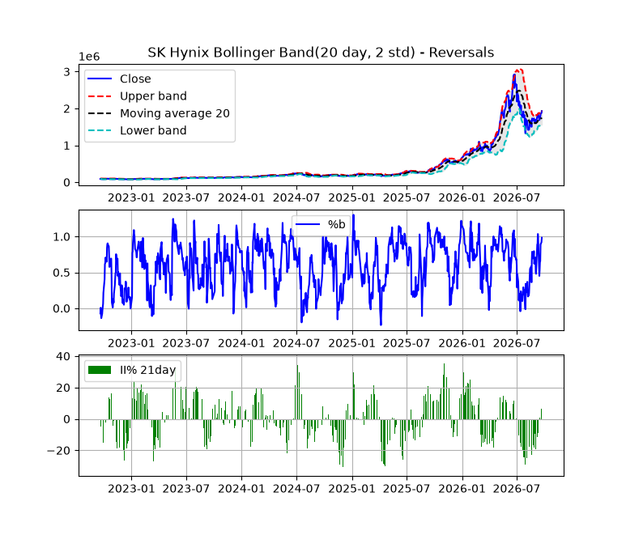
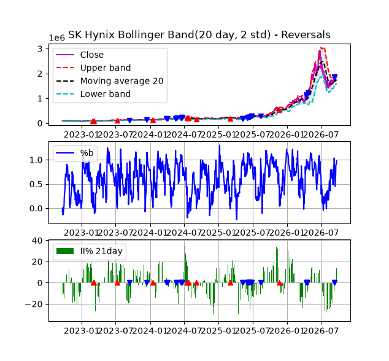
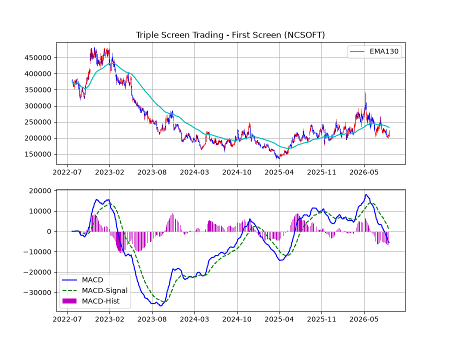
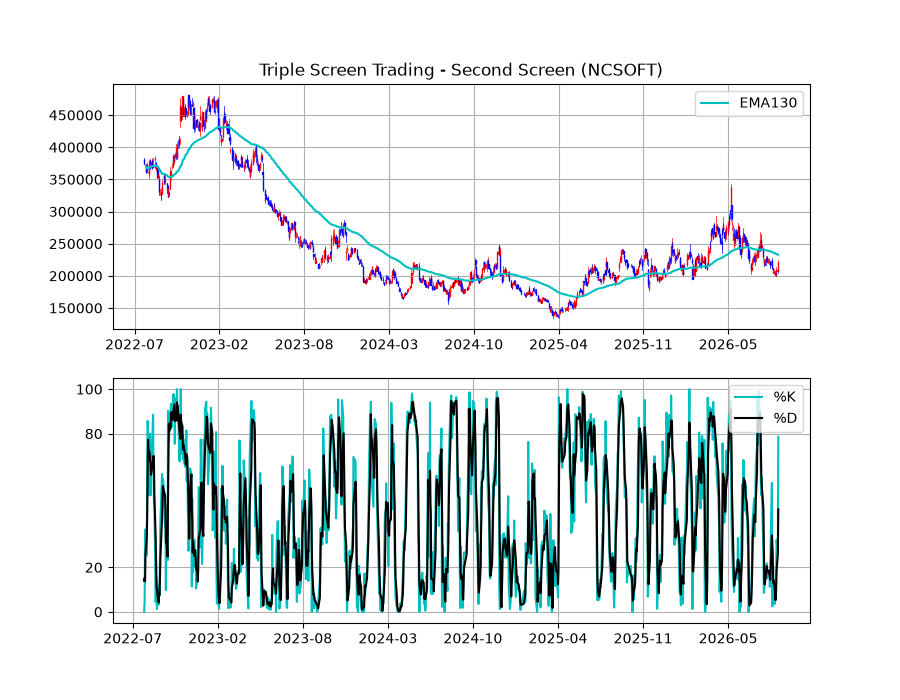
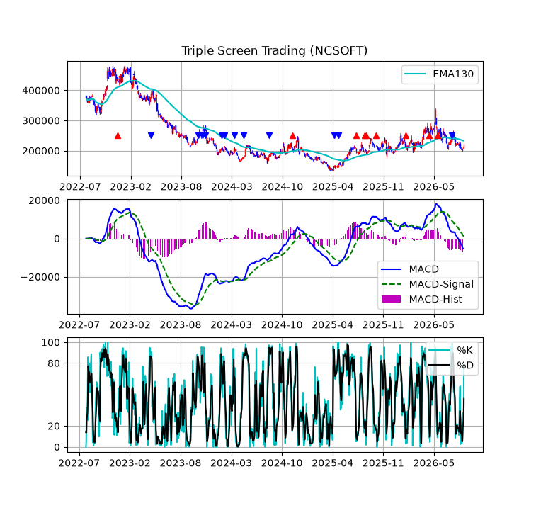

# ch6 학습 노트

6장에서 다루는 스크립트별 개념 정리 노트입니다. 프로젝트 전체 설정/실행 방법은
루트의 `README.md`를 참고하세요.

## `6_1_efficient_frontier.py` — 몬테카를로 시뮬레이션으로 효율적 투자선(Efficient Frontier) 구하기

### 몬테카를로 시뮬레이션이란

정답을 수식으로 한 번에 풀기 어려울 때, 무작위로 수많은 경우의 수를 만들어서
그 결과들을 통계적으로 관찰해 답에 가까운 패턴을 찾아내는 방법입니다. 여기서는
"여러 종목을 어떤 비중으로 섞어야 가장 효율적인 포트폴리오가 되는가"라는
질문에, 비중 조합을 하나하나 계산해서 최적해를 찾는 대신 비중을 20,000번
무작위로 뽑아보고 그 결과들을 흩뿌려서 전체적인 경향(효율적 투자선)을
눈으로 확인하는 방식으로 적용했습니다.

### 코드 흐름

1. `mk.get_daily_price(...)`로 종목별(삼성전자, SK하이닉스, 현대자동차, NAVER)
   종가를 DB에서 가져와 하나의 데이터프레임으로 합침
2. `daily_ret = df.pct_change()` : 일별 수익률 계산
3. `annual_ret = daily_ret.mean() * 252` : 연간 기대수익률
   (1년 거래일수를 관례적으로 252일로 계산)
4. `annual_cov = daily_ret.cov() * 252` : 연간 공분산 행렬
   (종목 간 수익률이 서로 어떻게 같이 움직이는지)
5. 20,000번 반복하며 매번:
   - `weights = np.random.random(len(stocks))`로 무작위 비중 생성 후
     `weights /= np.sum(weights)`로 합이 1이 되도록 정규화 (전액 투자,
     공매도 없음 가정 — 값이 항상 양수이므로 매수만 있는 포트폴리오)
   - 포트폴리오 기대수익률: `returns = weights · annual_ret`
     (각 종목 비중 × 연간 수익률의 가중합)
   - 포트폴리오 위험(변동성): `risk = sqrt(weightsᵀ · annual_cov · weights)`
     (마코위츠 포트폴리오 이론의 표준 공식 — 개별 위험뿐 아니라 종목 간
     상관관계까지 반영)
6. 20,000개의 (수익률, 위험) 쌍을 산점도로 그림

### 결과 해석

산점도에 찍힌 점 하나하나가 서로 다른 비중으로 구성한 포트폴리오 하나예요.
점들이 만드는 영역의 **왼쪽 위 경계선**이 "효율적 투자선(Efficient Frontier)"
입니다 — 같은 위험 수준에서 가장 높은 수익률을 내는(또는 같은 수익률에서
가장 낮은 위험을 갖는) 포트폴리오들의 집합이라는 뜻이에요. 이 경계선 안쪽
점들은 굳이 선택할 이유가 없는(더 나은 대안이 항상 존재하는) 비효율적인
조합입니다.

### 실행 시 주의할 점

`get_daily_price()`로 조회하는 기간이 실제 DB에 저장된 범위(현재
2022-08-19 ~ 오늘) 안에 있어야 합니다. 책 원본 예제의 2016~2018년처럼
DB에 없는 기간을 조회하면 빈 데이터프레임이 반환되고, 이후 계산이 전부
`NaN`이 되어 산점도가 텅 빈 채로 나옵니다.

---

## `6_2_sharpe_ratio.py` — 샤프 지수(Sharpe Ratio)로 최적 포트폴리오 찾기

`6_1_efficient_frontier.py`에서는 20,000개의 무작위 포트폴리오를 그냥 흩뿌려 보기만 했다면,
`6_2_sharpe_ratio.py`는 그중 "가장 효율적인 포트폴리오가 어느 것인지"를 숫자로 콕
짚어내는 단계입니다.

### 샤프 지수란

투자에서 위험(변동성) 한 단위당 얼마만큼의 수익을 얻고 있는지를 나타내는
지표입니다. 수익률이 같아도 위험이 더 낮으면 더 좋은 포트폴리오고, 위험이
같아도 수익률이 더 높으면 더 좋은 포트폴리오인데, 샤프 지수는 이 둘을
하나의 숫자로 합쳐서 "위험 대비 얼마나 효율적인가"를 비교할 수 있게
해줍니다. 원래 공식은 `(포트폴리오 수익률 − 무위험 수익률) ÷ 포트폴리오
위험`이지만, 이 코드에서는 무위험 수익률(예금 이자처럼 위험 없이 얻을 수
있는 수익)을 0으로 가정하고 단순화해서 `수익률 ÷ 위험`으로 계산합니다
(34번째 줄, `sharpe_ratio.append(returns/risk)`). 값이 클수록 위험 대비
수익이 좋은, 즉 "효율이 좋은" 포트폴리오라는 뜻입니다.

### `6_1_efficient_frontier.py`에서 추가/변경된 부분

- `sharpe_ratio` 리스트를 새로 만들어서, 매 시뮬레이션마다 `returns/risk`
  값을 저장 (① 부분)
- 결과 데이터프레임에 `Sharpe` 컬럼을 추가 (② 부분)
- `df['Sharpe'].max()`로 20,000개 중 샤프 지수가 가장 높은 포트폴리오를
  찾음 → `max_sharpe` (③ 부분) — **위험 대비 수익이 가장 좋은, 이론상
  "최적 포트폴리오"**
- `df['Risk'].min()`로 위험이 가장 낮은 포트폴리오를 찾음 → `min_risk`
  (④ 부분) — 수익은 낮더라도 가장 안전한 포트폴리오
- 산점도를 그릴 때 점 색깔을 샤프 지수 값에 따라 다르게 칠함
  (`c='Sharpe', cmap='viridis'`, ⑤ 부분) — 색이 밝을수록(또는 색상표
  기준 높은 값일수록) 효율이 좋은 포트폴리오라는 걸 한눈에 보여줌
- 그 위에 최적 포트폴리오는 빨간 별(★, ⑥ 부분)로, 최소 위험 포트폴리오는
  빨간 X(⑦ 부분)로 따로 표시해서 튀어 보이게 강조

### 결과 해석

산점도 전체는 `6_1_efficient_frontier.py`와 같은 효율적 투자선 모양이지만, 이번엔 색깔로
"어디가 효율이 좋은 구간인지"를 바로 알 수 있고, 그중에서도 별 표시가
있는 지점이 이 20,000번의 시뮬레이션 중 가장 효율적이라고 판단된
포트폴리오(각 종목별 투자 비중)입니다. X 표시는 "손실 위험을 최소한으로
줄이고 싶다면 이 비중으로"에 해당하는 지점이고요. 실제 투자 비중이
궁금하면 `max_sharpe`/`min_risk` 데이터프레임의 각 종목 컬럼 값을
출력해보면 됩니다 (예: `print(max_sharpe)`).

### 참고

`6_1_efficient_frontier.py`와 마찬가지로 `get_daily_price()` 조회 기간은 실제 DB에 저장된
범위(2022-08-19 ~ 오늘) 안이어야 정상적으로 값이 나옵니다.

---

## `6_3_1_bollinger_band.py` — 볼린저 밴드 기본 시각화

### 볼린저 밴드란

주가가 이동평균선을 중심으로 표준편차만큼 위아래로 움직이는 통계적 특성을
이용한 지표입니다. 평균 주변에 "밴드(띠)"를 그려서, 주가가 그 밴드의
위쪽에 가까우면 상대적으로 비싸게(과매수), 아래쪽에 가까우면 상대적으로
싸게(과매도) 거래되고 있다고 해석합니다. 정규분포를 가정하면 평균 ± 2
표준편차 안에는 약 95%의 데이터가 들어오기 때문에, 주가가 밴드를 벗어나는
경우는 통계적으로 드문 상황(추세 전환 또는 급등락 신호)으로 봅니다.

### 코드 흐름

1. `mk.get_daily_price('NAVER', '2019-01-02')` : 시작일만 지정하면
   종료일은 자동으로 오늘 날짜가 됨
2. `df['MA20'] = df['close'].rolling(window=20).mean()` (①) : 최근 20일
   종가의 이동평균 — 밴드의 중심선
3. `df['stddev'] = df['close'].rolling(window=20).std()` (②) : 최근 20일
   종가의 표준편차 — 최근 변동성이 얼마나 컸는지
4. `df['upper']`/`df['lower']` (③④) : 이동평균에 표준편차의 2배를
   더하고 뺀 값 — 상단 밴드/하단 밴드
5. `df = df[19:]` (⑤) : `rolling(window=20)`은 처음 19일치는 계산할
   데이터가 부족해 `NaN`이 되므로, 그 구간을 잘라내고 20번째 날부터
   사용
6. `plt.plot(...)` (⑥⑦) : 종가, 상단 밴드, 이동평균, 하단 밴드를 각각
   다른 색/선 스타일로 그림
7. `plt.fill_between(df.index, df['upper'], df['lower'], color='0.9')`
   (⑧) : 상단 밴드와 하단 밴드 사이를 옅은 회색으로 채워서 밴드 폭을
   한눈에 보이게 함

### 결과 해석

파란 실선(종가)이 회색 밴드 위쪽 경계(빨간 점선)에 닿거나 뚫고 올라가면
단기적으로 많이 오른 상태, 아래쪽 경계(하늘색 점선)에 닿으면 단기적으로
많이 내린 상태로 볼 수 있습니다. 회색 밴드 자체의 폭도 중요한 정보인데,
밴드가 좁아지는 구간은 변동성이 줄어든(횡보) 시기, 밴드가 넓어지는 구간은
변동성이 커진(급등락) 시기를 의미합니다.

### 참고

`end_date`를 생략하면 자동으로 오늘 날짜까지 조회되기 때문에, DB에 저장된
기간(2022-08-19 ~ 오늘) 중 시작일이 그보다 이전이어도 에러 없이 실제
보유 기간부터의 데이터만 정상적으로 그려집니다.

---
## `6_3_2_bollinger_percent_b.py` — %B 지표로 밴드 안 위치를 숫자로 나타내기

### %B란

종가가 볼린저 밴드의 상단과 하단 사이 어디쯤에 위치하는지를 0~1 사이의
숫자 하나로 표준화한 지표입니다.

값이 1이면 종가가 상단 밴드에 딱 붙어있다는 뜻이고, 0이면 하단 밴드에
붙어있다는 뜻, 0.5면 정확히 20일 이동평균선(밴드 중심) 위에 있다는
뜻입니다. 밴드 폭은 종목·시기마다 다 다른데, %B로 바꿔두면 "밴드 안에서
상대적으로 어디에 있는지"를 항상 같은 0~1 기준으로 비교할 수 있어서
편리합니다.

### `6_3_1_bollinger_band.py` 대비 달라진 점

- `df['PB'] = (df['close'] - df['lower']) / (df['upper'] - df['lower'])`
  (①)로 %B 컬럼 추가
- 그래프를 위아래 두 개로 나눔 (`plt.subplot(2, 1, 1)`/`(2, 1, 2)`, ②③) —
  위쪽엔 기존 밴드+종가 차트, 아래쪽엔 %B만 따로 그려서(④) 밴드 안
  위치가 시간에 따라 어떻게 움직이는지 한눈에 보여줌

### 결과 해석

아래쪽 %B 그래프가 1에 가까워지면 상단 밴드 근처(단기 과열), 0에
가까워지면 하단 밴드 근처(단기 침체)라고 해석합니다. 위쪽 가격 차트와
비교해보면, %B가 1 근처를 찍을 때가 위쪽 차트에서 종가가 상단 밴드에
닿는 시점과 정확히 일치하는 걸 확인할 수 있어요.

---

## `6_3_3_bollinger_mfi_trend_following.py` — MFI(자금흐름지수)까지 결합한 매매 신호

### MFI(Money Flow Index)란

가격뿐 아니라 거래량까지 반영해서 "매수세와 매도세 중 어느 쪽이
우세한가"를 0~100 사이 숫자로 나타내는 지표입니다(RSI와 비슷하지만
거래량 가중치가 들어간 버전). 계산 순서는 이렇습니다.

1. `TP`(대표가격) = (고가+저가+종가) / 3
2. 오늘 `TP`가 어제 `TP`보다 높으면, 오늘의 `TP × 거래량`을 "긍정적
   자금흐름(PMF)"으로, 아니면 "부정적 자금흐름(NMF)"으로 분류
3. 최근 10일간 `PMF` 합 ÷ `NMF` 합 = `MFR`
4. `MFI10 = 100 - 100 / (1 + MFR)`

값이 80을 넘으면 최근 매수 자금이 과도하게 몰린(과매수) 상태, 20 밑이면
매도 자금이 과도하게 몰린(과매도) 상태로 봅니다.

### 매매 신호 로직 (① ~ ④)

- `%B > 0.8` **그리고** `MFI10 > 80` → 가격도 상단 밴드 근처, 자금
  흐름도 과열 → 둘 다 과열 신호가 겹치므로 **매수 신호**로 보고 빨간
  세모(▲)로 표시
- `%B < 0.2` **그리고** `MFI10 < 20` → 가격도 하단 밴드 근처, 자금
  흐름도 침체 → **매도 신호**로 보고 파란 역세모(▼)로 표시

가격 지표(%B)와 거래량 지표(MFI)를 **둘 다** 만족할 때만 신호로 인정하는
게 핵심이에요. 가격만 보고 판단하면 거래량이 안 받쳐주는 "가짜 신호"에
속기 쉬운데, 두 조건을 동시에 요구해서 신호의 신뢰도를 높이는 방식입니다.

### 결과 해석

위쪽 차트에서 빨간 세모/파란 역세모가 찍힌 지점이 매도/매수 후보
시점이고, 아래쪽 %B·MFI10 그래프에서도 같은 지점에 표시가 찍혀서 두
지표가 동시에 극단값을 찍었는지 바로 확인할 수 있습니다.

### 참고: 최신 pandas 호환성 수정

책 원본 코드는 `df.column.values[i] = 값`처럼 넘파이 배열에 직접 대입하는
방식을 쓰는데, 최신 pandas(Copy-on-Write 방식)에서는 이 배열이 읽기
전용이라 `ValueError: assignment destination is read-only` 에러가
납니다. `df.loc[idx, '컬럼명'] = 값`처럼 pandas가 공식 지원하는 방식으로
바꿔서 해결했습니다.

===
## 6.4 일중강도(II)를 이용한 역추세(Reversal) 매매기법

6.3절이 "추세가 계속될 것"이라 보고 매매하는 추세추종 전략이었다면,
6.4절은 반대로 "과도하게 밀렸으니 곧 반등할 것"이라 보고 매매하는
역추세(반전) 전략입니다.

### 일중강도(II)와 IIP21이란

II = (2×종가 − 고가 − 저가) / (고가 − 저가) × 거래량
이 식의 앞부분 `(2×종가−고가−저가)/(고가−저가)`은 그날 종가가 하루 중
어디쯤에서 마감했는지를 −1~+1 사이 값으로 나타냅니다. 고가에서
마감하면 +1(장중 매수세가 끝까지 강했다는 뜻), 저가에서 마감하면
−1(장중 매도세가 끝까지 강했다는 뜻)이 됩니다. 여기에 거래량을 곱해서,
"그날 매수/매도 강도가 거래량까지 고려했을 때 얼마나 셌는지"를
숫자로 만든 게 `II`입니다.

IIP21 = (최근 21일 II 합계) / (최근 21일 거래량 합계) × 100

`II`를 21일치 누적해서 거래량 대비 백분율로 정규화한 지표입니다.
양수면 최근 21일간 매집(누적 매수)이, 음수면 분산(누적 매도)이
우세했다는 뜻이에요.

### `6_4_1_intraday_intensity.py` — 지표 시각화만

3단 차트로 SK하이닉스의 볼린저 밴드+종가(1단), %B(2단),
IIP21 막대그래프(3단)를 그냥 나란히 그려서 눈으로 비교해보는
단계입니다. 아직 매매 신호는 표시하지 않아요. `df[19:]` 대신
`df.dropna()`를 쓴 점이 눈에 띄는데, `IIP21`은 21일 이동 윈도우라 앞의
20개 행이 `NaN`이 되어 `MA20`(19개 `NaN`)보다 하나 더 많이 잘려야
하거든요. 몇 번째 행부터 잘라야 할지 직접 계산하는 대신 `dropna()`로
`NaN`이 있는 행을 전부 걸러내면, 어떤 지표를 추가하든 신경 쓸 필요
없이 항상 안전합니다.

### `6_4_2_bollinger_reversals.py` — 다이버전스 기반 반전 신호

`6_4_1_intraday_intensity.py`와 코드는 거의 같고, 매매 신호 판단 로직만 추가됐습니다.

- `PB < 0.05` (종가가 하단 밴드에 거의 붙음, 극단적 과매도) **그리고**
  `IIP21 > 0` (그런데도 최근 매집 흐름은 여전히 플러스) → 가격은
  바닥인데 자금은 오히려 들어오고 있는 **다이버전스(가격과 지표의
  엇갈림)** → 곧 반등할 가능성으로 보고 **매수 신호**(빨간 삼각형)
- `PB > 0.95` (상단 밴드에 거의 붙음, 극단적 과매수) **그리고**
  `IIP21 < 0` (그런데도 자금은 빠져나가는 중) → **매도 신호**
  (파란 역삼각형)

6.3절의 추세추종 전략과 정반대 발상이에요. 추세추종은 "밴드 돌파 +
지표 강세"가 같은 방향일 때 신호를 냈다면(추세가 힘있게 이어질 것),
여기서는 "밴드는 극단인데 지표는 반대 방향"일 때, 즉 가격과 자금
흐름이 서로 엇갈릴 때(다이버전스) 신호를 냅니다.

### 결과 해석

1단 차트에서 빨간 삼각형이 찍힌 지점은 "가격은 바닥권인데 매집이
들어오고 있어 반등이 기대되는" 시점, 파란 역삼각형은 그 반대입니다.
3단(IIP21 막대) 차트에도 같은 지점에 표시가 찍혀서, 실제로 그 시점의
자금흐름이 가격 움직임과 엇갈리고 있었는지 바로 대조해볼 수 있습니다.

## 6.6 삼중창 매매시스템 (Triple Screen Trading System)

알렉산더 엘더(Alexander Elder)가 고안한 매매기법으로, "장기 추세는 어느
방향인지"와 "지금이 그 추세 안에서 진입하기 좋은 타이밍인지"를 서로 다른
두 개의 창(지표)으로 나눠서 확인하는 방식입니다. 핵심 원칙은 **장기
추세와 같은 방향으로만 매매하되, 단기적으로 그 추세에 반하는 눌림목/
되돌림이 나왔을 때 진입한다**는 것입니다.

> DB에 "엔씨소프트"가 "NC"로 잘못 저장돼있는 문제로, 아래 코드들은
> 종목명을 `'NC'`로 넣고 있습니다(저번에 확인한 그 이슈입니다).

### `6_6_1_triple_screen_first.py` — 1차 창: MACD로 장기 추세 파악

`6_5_1.py`에서 다룬 MACD 계산(EMA60, EMA130, MACD선, 신호선,
히스토그램)을 그대로 재사용합니다. 캔들차트 위에 EMA130(장기
이동평균)을 겹쳐 그리고, 아래 칸에 MACD 지표를 그려서 "지금 장기
추세가 상승인지 하락인지"를 1차적으로 판단하는 화면입니다. 삼중창
시스템에서 이 화면은 "어느 방향으로 매매할지"만 결정하고, 실제 진입
타이밍은 아직 정하지 않습니다.

### `6_6_1_2_triple_screen_first_mplfinance.py` — 1차 창을 최신 `mplfinance`로 다시 그리기

`6_6_1_triple_screen_first.py`와 완전히 같은 내용을, 지원 종료된 `mpl_finance` 대신 최신
`mplfinance` 라이브러리로 다시 구현한 버전입니다.

- `df.index = pd.to_datetime(df.date)` : `mplfinance`는 날짜 인덱스를
  직접 요구해서, `mpl_finance` 때처럼 `mdates.date2num`으로 숫자 변환할
  필요가 없어짐
- `mpf.make_addplot(...)`으로 EMA130(캔들 위에 겹쳐 그림)과
  MACD 히스토그램/선/신호선(별도 패널)을 한 번에 정의
- `mpf.make_marketcolors(up='r', down='b', ...)` : `mplfinance`
  기본값은 미국식(상승=초록, 하락=빨강)이라, 한국식(상승=빨강,
  하락=파랑)으로 맞추려면 색상을 직접 지정해야 함
- `mpf.plot(..., panel_ratios=(1,1), ...)` 한 줄로 캔들+지표 전체를
  그림

앞으로 `mpl_finance`가 완전히 동작을 멈추면 이 버전을 쓰면 됩니다.

### `6_6_2_triple_screen_second.py` — 2차 창: 스토캐스틱으로 단기 타이밍 잡기

MACD로 큰 추세를 확인했다면, 이번엔 짧은 기간의 오실레이터로 "지금
당장 진입하기 좋은 시점인지"를 봅니다.

%K(fast_k) = (오늘 종가 − 최근 14일 최저가) / (최근 14일 최고가 − 최근 14일 최저가) × 100
%D(slow_d) = %K의 3일 이동평균

`%K`는 최근 14일간의 고가·저가 범위 안에서 오늘 종가가 상대적으로 어디
위치하는지를 0~100 사이 값으로 나타냅니다. 100에 가까우면 최근 14일 중
최고가 근처에서, 0에 가까우면 최저가 근처에서 마감했다는 뜻이에요.
`%D`는 `%K`의 노이즈를 줄인 신호선입니다. 관례적으로 80 이상은 과매수,
20 이하는 과매도로 해석합니다(RSI, MFI와 비슷한 해석). 이 스크립트는
캔들+EMA130(위)과 %K/%D(아래) 두 칸만 그려서 아직 매매 신호를 표시하진
않습니다.

### `6_6_3_triple_screen_signals.py` — 1차·2차 창을 결합해 실제 매수/매도 신호 만들기

앞의 두 창을 하나의 조건으로 합쳐서, 진짜 매매 신호를 표시합니다.

- **매수 신호(빨간 ▲)**: `ema130.values[i-1] < ema130.values[i]`
  (EMA130이 상승 중, 즉 1차 창 기준 장기 추세가 상승) **그리고**
  `slow_d`가 어제는 20 이상이었다가 오늘 20 밑으로 하향 돌파 (2차 창
  기준 단기 과매도 눌림목 발생) → 상승 추세 속의 일시적 조정으로 보고
  매수
- **매도 신호(파란 ▼)**: `ema130.values[i-1] > ema130.values[i]`
  (장기 추세가 하락) **그리고** `slow_d`가 어제는 80 이하였다가 오늘
  80 위로 상향 돌파 (단기 과매수 반등 발생) → 하락 추세 속의 일시적
  반등으로 보고 매도(회피)

이게 삼중창 매매시스템의 핵심이에요 — **장기 추세와 반대 방향으로는
절대 매매하지 않고**, 그 추세 안에서 단기 지표가 일시적으로 반대
방향(과매도/과매수)으로 튄 순간만 진입 타이밍으로 삼는 거죠. 화면
구성도 3단으로 늘어나서, 위(캔들+EMA130), 중간(MACD), 아래(%K/%D)를
한 화면에서 다 확인하면서 신호가 왜 나왔는지 바로 대조할 수 있습니다.

## 6.7 듀얼 모멘텀(Dual Momentum) 전략

"최근에 수익률이 좋았던 자산이 앞으로도 당분간 잘 갈 가능성이 높다"는
모멘텀 효과를 이용한 투자 전략입니다. 게리 안토나치가 제안한 듀얼
모멘텀은 이걸 두 단계로 나눠서 검증합니다.

- **상대 모멘텀**: 여러 종목을 서로 비교해서, 특정 기간 동안 수익률이
  가장 좋았던 종목들을 골라내는 것 (횡단면 비교)
- **절대 모멘텀**: 그렇게 고른 종목들을 실제로 들고 있었다면 그 다음
  기간에도 계속 수익이 났는지 시계열로 검증하는 것

### `6_7_dual_momentum.py` — `DualMomentum` 클래스

`get_rltv_momentum(start_date, end_date, stock_count)` — 상대 모멘텀
계산:

1. 사용자가 입력한 날짜가 주말·공휴일이라 실제 거래일이 아닐 수 있으니,
   `SELECT MAX(date) WHERE date <= 입력일자`로 그 이전 가장 가까운
   실제 거래일로 자동 보정
2. `self.mk.codes`에 있는 전체 KRX 종목을 하나씩 돌면서, 시작일
   종가(`old_price`)와 종료일 종가(`new_price`)를 각각 조회
3. 그 기간 시세가 없는 종목(신규 상장, 거래정지 등)은 `continue`로
   건너뜀
4. `수익률 = (new_price / old_price - 1) × 100`을 계산해서 내림차순
   정렬한 뒤, 상위 `stock_count`개만 잘라서 반환

`get_abs_momentum(rltv_momentum, start_date, end_date)` — 절대 모멘텀
검증:

- 위에서 뽑힌 종목들"만" 대상으로, 이번엔 **다른(보통 그 다음) 기간**에
  대해 똑같은 방식으로 수익률을 계산
- "상대 모멘텀으로 고른 종목들을 그 다음 기간에도 계속 들고 있었다면
  평균적으로 얼마나 벌었을까"를 확인하는 단계 — 모멘텀이 실제로
  이어지는지 검증하는 것

지난번에 고친 두 버그(비밀번호를 문자열 그대로 쓰던 것 →
`os.getenv('DB_PASSWORD')`로 수정, `pd.Index(range(stock_count))`가
실제 결과 개수와 안 맞을 수 있던 것 → `range(len(df))`로 수정)가
반영된 버전입니다.

### `6_7_run_dual_momentum.py` — 실행 예시

`6_7_dual_momentum.py`는 클래스 정의만 있는 "모듈" 파일이라, 이것만 실행하면 화면에
아무 출력도 안 뜹니다. `6_7_run_dual_momentum.py`가 실제로 이 클래스를 불러다 써서
결과를 보여주는 역할이에요. 파일명이 숫자로 시작하는 `6_7_dual_momentum.py`는
일반적인 `import` 문으로 불러올 수 없어서, `importlib.util`로 파일
경로를 직접 지정해서 모듈처럼 불러오는 방식을 썼습니다.

1. 2025-01-01 ~ 2025-06-30(형성기간) 동안 수익률 상위 10종목을 상대
   모멘텀으로 선정
2. 그 10종목을 2025-07-01 ~ 2025-12-31(보유기간) 동안 계속 들고
   있었다면 어떤 수익률이 났을지 절대 모멘텀으로 확인

### 결과 해석

두 단계에서 출력되는 평균 수익률을 비교해보면 됩니다. 형성기간의
평균 수익률(상대 모멘텀)보다 그 다음 보유기간의 평균 수익률(절대
모멘텀)이 비슷하거나 더 높으면 모멘텀 효과가 이어졌다는 뜻이고, 뚝
떨어지거나 마이너스로 돌아서면 그 시기·종목군에서는 모멘텀이 이어지지
않았다는 뜻입니다.

### 참고: 실행 속도

전체 종목(2,700개 이상)을 한 종목씩 순회하면서 매번 개별 SQL 쿼리를
2번씩 날리는 구조라(시작일 조회 + 종료일 조회), 실행에 시간이 좀
걸릴 수 있습니다. 책 원본 방식 그대로라 기능상 문제는 없지만, 느리게
느껴지면 나중에 `IN` 절로 여러 종목을 한 번에 조회하도록 최적화할 수도
있습니다(지금은 건드리지 않았어요).