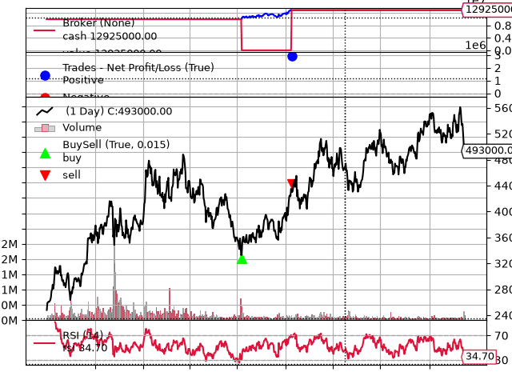
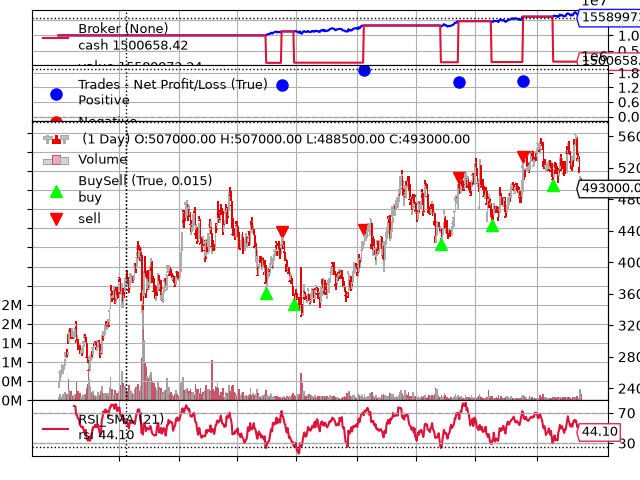

# ch7 — 장고(Django) 웹 서버 실습

7장 실습 기록입니다. 장고 프로젝트 자체는 이 저장소 밖인 `C:\mySite\Investar`에
있고, 가상환경은 다른 장과 같은 `C:\workspaces\quant\quant.venv`를 사용합니다.

## 환경

- Django 5.2.17 (`quant.venv`에 설치)
- 프로젝트 위치: `C:\mySite\Investar`
- 앱: `hello` (`settings.py`의 `INSTALLED_APPS`에 등록)

```
C:\mySite\Investar\
├── manage.py
├── db.sqlite3
├── Investar\        # 프로젝트 설정 (settings.py, urls.py 등)
└── hello\           # Hello 앱 (views.py의 sayHello)
```

## 서버 실행 방법

```
C:\workspaces\quant\quant.venv\Scripts\activate
cd C:\mySite\Investar
python manage.py runserver
```

프롬프트 앞에 `(quant.venv)`가 붙어 있는지 확인한 뒤 실행합니다.
정상적으로 뜨면 아래처럼 나옵니다.

```
System check identified no issues (0 silenced).
Django version 5.2.17, using settings 'Investar.settings'
Starting development server at http://127.0.0.1:8000/
```

서버를 끄려면 터미널에서 `Ctrl+C`를 누릅니다. 마지막의
`WARNING: This is a development server...`는 개발용 서버라는 안내라서 무시해도 됩니다.

## 접속 주소

`Investar/urls.py`가 대문자로 시작하는 영문 이름만 받도록 되어 있습니다.

```python
re_path(r'^(?P<name>[A-Z][a-z]*)$', views.sayHello),
```

- `http://127.0.0.1:8000/Seram` → "Hello, Seram!" 출력
- `http://127.0.0.1:8000/` → 404 (루트 주소를 연결하지 않았으므로 정상)
- `http://127.0.0.1:8000/admin/` → 장고 관리자 페이지

## 겪은 문제와 해결 (2026-11-16)

### 1. 서버가 안 열림 — 가상환경에 Django가 없었음

`quant.venv`에 Django가 설치되어 있지 않아 `runserver`가 실행되지 않았습니다.
가상환경을 켠 상태에서 프로젝트를 만들 때 쓴 버전과 같은 버전을 설치해서 해결했습니다.

```
pip install django==5.2.17
```

### 2. Investar 폴더가 두 개 — 철자가 다른 오타 프로젝트

`C:\mySite` 안에 `Investar`(a)와 `Invester`(e)가 같이 있었습니다.
`Invester`는 `django-admin startproject` 때 이름을 잘못 입력해서 생긴 빈
프로젝트(`hello` 앱 없음)라서 삭제했고, 지금은 `Investar`만 남아 있습니다.
오타 폴더에서 서버를 띄우면 `/Seram` 같은 주소도 404가 나므로, 반드시
`C:\mySite\Investar`에서 실행합니다.

### 3. 가상환경이 실습 폴더 밖에 있어도 되는가

됩니다. 가상환경은 위치가 아니라 활성화 여부만 중요해서, 한 번 활성화하면
그 터미널에서는 어느 폴더로 이동해도 같은 파이썬과 패키지를 씁니다.

- 새 터미널을 열 때마다 `activate`를 다시 실행해야 합니다.
- VS Code에서 `quant_실습` 폴더만 열면 가상환경을 못 찾을 수 있으니,
  `Ctrl+Shift+P` → "Python: Select Interpreter"에서
  `C:\workspaces\quant\quant.venv\Scripts\python.exe`를 지정합니다.
- 가상환경 폴더는 옮기거나 이름을 바꾸면 깨지므로 그대로 둡니다.

### 4. `startapp hello`가 CommandError — 이미 만든 앱

```
CommandError: 'hello' conflicts with the name of an existing Python module
and cannot be used as an app name.
```

`hello` 앱을 9월 29일에 이미 만들어 두었기 때문에 나오는 메시지입니다.
같은 이름으로 다시 만들 수 없을 뿐 문제는 아니므로, 이 단계는 건너뜁니다.

## 진행 상황 (2026-11-17 기준)

| 단계 | 상태 | 비고 |
|---|---|---|
| 장고 설치, `Investar` 프로젝트 생성 | 완료 | `C:\mySite\Investar` |
| `migrate`, 서버 실행 | 완료 | 마이그레이션 18건 적용, `runserver` 성공 |
| `hello` 앱 생성 및 등록 | 완료 | `INSTALLED_APPS`에 `'hello'` |
| `urls.py` 연결, `sayHello` 뷰 | 완료 | `/Seram` → "Hello, Seram!" |
| 관리자 페이지 (`createsuperuser`) | 완료 | `/admin/` 로그인 확인 |
| 인덱스 페이지 (`index` 앱, 템플릿, CSS) | 완료 | `/index/` 접속 확인 |
| 계좌 잔고 확인 (`balance` 앱) | 완료 | `/balance/?005930=10&000660=5` 확인 (11-17) |
| 슬랙 알림 메시지 | 완료 | `7_5.py`로 메시지 전송 확인 (11-17) |
| 백트레이더 백테스트 | 완료 | `7_6_1.py`, `7_6_2.py` 실행 확인 (11-17) |

## 관리자 페이지

관리자 계정을 만든 뒤 `/admin/`으로 로그인합니다. `migrate`는 이미 되어
있으므로 다시 할 필요가 없습니다.

```
cd C:\mySite\Investar
python manage.py createsuperuser
python manage.py runserver
```

- `createsuperuser`는 Username, Email(비워도 됨), Password를 차례로 묻습니다.
  비밀번호는 입력해도 화면에 표시되지 않는 것이 정상입니다.
- 접속 주소: `http://127.0.0.1:8000/admin/`
- 계정 정보는 `db.sqlite3`에 저장되며, 비밀번호는 README나 코드에 적지 않습니다.

## 인덱스 페이지

`index` 앱을 만들어 템플릿(HTML)과 정적 파일(CSS, 이미지)을 연결했습니다.

```
index\
├── views.py                  # main_view: render(request, 'index.html')
├── templates\index.html      # 책 예제 ch07_02_index.html
└── static\index\
    ├── style.css             # 책 예제 ch07_03_style.css
    └── Django_Logo.jpg
```

- `settings.py`의 `INSTALLED_APPS`에 `'index'` 추가
- `urls.py`에 `from index import views as index_views`와
  `path('index/', index_views.main_view)` 추가
- 접속 주소: `http://127.0.0.1:8000/index/`

### 겪은 문제: `TemplateDoesNotExist at /index/`

파일과 설정이 모두 맞는데도 에러가 났습니다. 예전에 띄운 서버 프로세스가
남아서 8000번 포트 요청을 받고 있었던 것으로 보이며(그 서버는 `templates`
폴더가 생기기 전에 시작되어 폴더를 모름), 남은 프로세스를 정리하고 서버를
다시 띄워 해결했습니다.

```
netstat -ano | findstr :8000
taskkill /F /PID 숫자
python manage.py runserver
```

`templates`나 `static` 폴더를 새로 만든 뒤에는 서버를 완전히 껐다가 다시 켭니다.

## 계좌 잔고 확인 (2026-11-17)

주소에 종목코드와 주식 수를 넣으면 현재가를 가져와 평가금액 표를 보여 주는
`balance` 앱을 만들었습니다.

```
balance\
├── views.py                      # get_data(), main_view()
├── templates\balance.html        # 책 예제 ch07_05_balance.html
└── static\balance\b_style.css    # 책 예제 ch07_06_b_style.css
```

- `python manage.py startapp balance` (성공하면 아무것도 출력하지 않음)
- `settings.py`의 `INSTALLED_APPS`에 `'balance'` 추가
- `urls.py`에 `from balance import views as balance_views`와
  `path('balance/', balance_views.main_view)` 추가
- 접속 주소: `http://127.0.0.1:8000/balance/?005930=10&000660=5`
  (`종목코드=주식수`를 `&`로 연결. 예시는 삼성전자 10주, SK하이닉스 5주)

실행 결과 (2026-11-17):

| 종목명 | 종목코드 | 현재가 | 주식수 | 등락률 | 평가금액 |
|---|---|---|---|---|---|
| 삼성전자 | 005930 | 191,600 | 10 | -1.74% | 1,916,000 |
| SK하이닉스 | 000660 | 1,106,000 | 5 | -1.07% | 5,530,000 |
| 계좌 잔고 | | | | | 7,446,000 |

### 책 원본 대비 수정: 네이버 스크레이핑 → FinanceDataReader

책의 `views.py`(`ch07_04_balance_views.py`)는 네이버 금융 시세 페이지를
BeautifulSoup으로 스크레이핑하는데, 네이버 페이지 구조가 바뀌어 현재가
태그(`id='_nowVal'`)를 찾지 못하고 아래 에러가 났습니다. 주소를
`sise.naver`로 바꾸고 User-Agent 헤더를 넣어도 같았습니다.

```
AttributeError: 'NoneType' object has no attribute 'text'
```

그래서 5~6장과 같은 방식으로 바꿨습니다.

- 현재가와 등락률: `fdr.DataReader(종목코드, start=2주 전)`의 마지막 종가와
  전일 종가로 계산
- 종목명: `DBUpdater.py`와 같은 KRX 상장법인 목록에서 조회. `lru_cache`로
  서버 실행 중 한 번만 받아오고, 실패하면 종목코드를 대신 표시
- 평가금액 계산과 템플릿은 책 코드 그대로

표시되는 현재가는 FinanceDataReader가 주는 최근 종가라서, 장중에는 실시간
시세와 조금 차이가 날 수 있습니다. 첫 접속은 KRX 목록을 받아오느라 몇 초
걸립니다.

## 슬랙 알림 메시지 (2026-11-17)

`7_5.py`로 슬랙 봇이 채널에 메시지를 보내도록 했습니다. 서식이 섞인
텍스트(굵게, 코드, 기울임, 취소선)와 빨간 띠가 붙은 "오늘의 증시 KOSPI"
카드(차트 이미지 포함)가 채널에 올라오는 것을 확인했습니다.

### 준비 과정

1. 개인 슬랙 워크스페이스 생성 (회사 워크스페이스는 봇 설치에 관리자 승인이
   필요할 수 있어 따로 만듦)
2. `https://api.slack.com/apps` → "Create New App" → "Paste a manifest"로
   앱(`mySlackBot`) 생성. 매니페스트에 봇 권한 `chat:write`,
   `chat:write.public`을 넣음
3. "Install to Workspace"로 설치 후, "OAuth & Permissions" 페이지의
   "Bot User OAuth Token"(`xoxb-`로 시작)을 복사
4. `quant_실습\.env`에 두 줄 추가 (`.env`는 git 추적 제외)

   ```
   SLACK_BOT_TOKEN=xoxb-...
   SLACK_CHANNEL=#채널이름
   ```

5. 설치 및 실행

   ```
   pip install slack_sdk
   cd C:\workspaces\quant\quant_실습\ch7
   python 7_5.py
   ```

### 책 원본 대비 수정

- **`slacker` → `slack_sdk`**: 책의 `slacker` 라이브러리는 개발이 중단되어
  새로 만든 슬랙 앱에서 동작하지 않으므로, 슬랙 공식 라이브러리로 교체
  (`WebClient.chat_postMessage`)
- **토큰 하드코딩 제거**: 토큰과 채널을 코드에 쓰지 않고 `.env`에서 읽음
- **주소 수정**: 이미지/링크 주소에 `https://`를 붙이고 `.nhn`을 `.naver`로 변경

### 겪은 문제

- **`can't open file ... 7_5.py`**: 장고 폴더(`C:\mySite\Investar`)에서 실행함.
  `7_5.py`는 `quant_실습\ch7`에 있으므로 폴더를 옮겨서 실행
- **`전송 실패: invalid_auth`**: `.env`에 봇 토큰이 아닌 다른 값(24자)을 넣음.
  "OAuth & Permissions"의 `xoxb-`로 시작하는 토큰으로 교체
- **`전송 실패: channel_not_found`**: `SLACK_CHANNEL`에 워크스페이스 이름을
  적음. 슬랙 왼쪽 목록에 보이는 실제 채널 이름을 `#`과 함께 적어야 함
- **`python-dotenv could not parse statement starting at line 2`**: `.env`에
  `KEY=값` 형식이 아닌 메모 줄이 있어 나오는 경고. 동작에는 지장 없고,
  메모 줄 앞에 `#`을 붙이면 사라짐

## 서버 끄기와 다시 시작하기

- 끄기: 서버를 띄운 터미널에서 `Ctrl+C` 후 터미널 창을 닫습니다.
  파일과 `db.sqlite3`는 그대로 남으므로 따로 저장할 것은 없습니다.
- 다시 시작: 위 "서버 실행 방법"의 세 줄(`activate` → `cd` → `runserver`)을
  그대로 실행합니다.

## 백트레이더 백테스트 (2026-11-17)

백트레이더(backtrader)는 과거 시세에 매매 전략을 적용해 수익이 났을지
계산해 주는 백테스트 라이브러리입니다. 엔씨소프트(036570)의
2017-01-01 ~ 2019-12-01 시세에 RSI 전략을 돌려 봤습니다.

```
pip install backtrader
cd C:\workspaces\quant\quant_실습\ch7
python 7_6_1.py
python 7_6_2.py
```

| 파일 | 내용 |
|---|---|
| `7_6_1.py` | RSI(14일)가 30 미만이면 매수, 70 초과면 매도. 한 번에 30주 거래 |
| `7_6_2.py` | RSI_SMA(21일) 전략 + 수수료 0.14% + 매매 로그. 자산의 90%로 거래, 캔들 차트 |

공통 조건: 초기 투자금 10,000,000원.

### 7_6_1.py 실행 결과



- 차트는 위에서부터 자산 변화(Broker), 매매 손익(Trades), 주가와 매수(초록
  삼각형)·매도(빨간 삼각형) 시점, RSI입니다.
- 3년 동안 매수 1회, 매도 1회가 일어났고 이익으로 끝났습니다.
- 최종 자산: 12,925,000원 (초기 10,000,000원 대비 +2,925,000원, +29.25%)
- 차트 창을 닫아야 프로그램이 끝납니다.

### 7_6_2.py 실행 결과



- 캔들 차트(`style='candlestick'`)로 그려졌고, 아래 지표는 RSI_SMA(21일)입니다.
- 3년 동안 매수 5회, 매도 4회가 일어났습니다. 끝난 거래 4건은 모두 이익이었고,
  마지막 매수분은 기간 종료 시점에 보유 중입니다.
- 최종 자산: 15,589,973원 (초기 10,000,000원 대비 +5,589,973원, +55.90%)
- `7_6_1.py`보다 수익이 큰 이유: 30주 고정이 아니라 자산의 90%를 매번
  투입했고, RSI 기간이 달라 매매 신호가 더 자주 나왔기 때문입니다.
  수수료 0.14%는 매수·매도 때마다 빠집니다.

터미널 출력:

```
Initial Portfolio Value : 10,000,000 KRW
[2018-03-02] BUY  : 주가 370,000, 수량 24, 수수료 12,432, 자산 10,083,568
[2018-04-02] SELL : 주가 425,000, 수량 -24, 수수료 14,280, 자산 11,293,288
[2018-04-25] BUY  : 주가 358,000, 수량 28, 수수료 14,150, 자산 11,166,205
[2018-09-13] SELL : 주가 427,000, 수량 -28, 수수료 16,878, 자산 13,210,352
[2019-02-22] BUY  : 주가 444,000, 수량 27, 수수료 16,645, 자산 12,832,207
[2019-03-29] SELL : 주가 498,000, 수량 -27, 수수료 18,669, 자산 14,621,035
[2019-06-04] BUY  : 주가 467,500, 수량 28, 수수료 18,522, 자산 14,305,377
[2019-08-05] SELL : 주가 520,000, 수량 -28, 수수료 20,602, 자산 16,067,598
[2019-10-07] BUY  : 주가 509,000, 수량 29, 수수료 20,365, 자산 16,104,390
Final Portfolio Value   : 15,589,973 KRW
```

- 마지막 매수(2019-10-07, 509,000원 × 29주)는 팔지 않은 채 기간이 끝났고,
  종료 시점 주가가 493,000원이라 그만큼 평가손실이 반영됐습니다.

### 책 원본 대비 수정: YahooFinanceData → FinanceDataReader

책(`ch07_08_Backtrader_RSI.py`, `ch07_09_Backtrader_RSI_SMA.py`)은
`bt.feeds.YahooFinanceData`로 야후 파이낸스에서 시세를 받는데, 야후 쪽 변경으로
더 이상 동작하지 않습니다. 시세 조회만 아래처럼 바꿨고 전략 코드는 책
그대로입니다.

```python
df = fdr.DataReader('036570', '2017-01-01', '2019-12-01')
data = bt.feeds.PandasData(dataname=df)
```

## 파일 목록

```
ch7/
├── README.md
├── 7_5.py          # 슬랙 알림 메시지 (slack_sdk)
├── 7_6_1.py        # 백트레이더 RSI 전략
├── 7_6_2.py        # 백트레이더 RSI_SMA 전략 + 수수료 + 매매 로그
└── images/
    ├── 7_6_1.png   # 7_6_1.py 실행 결과 차트
    └── 7_6_2.png   # 7_6_2.py 실행 결과 차트
```

장고 프로젝트(7.1~7.4절)는 이 폴더가 아니라 `C:\mySite\Investar`에 있습니다.

## 다음에 할 일

- 8장 변동성 돌파 전략 (슬랙 봇을 매매 알림에 사용)
