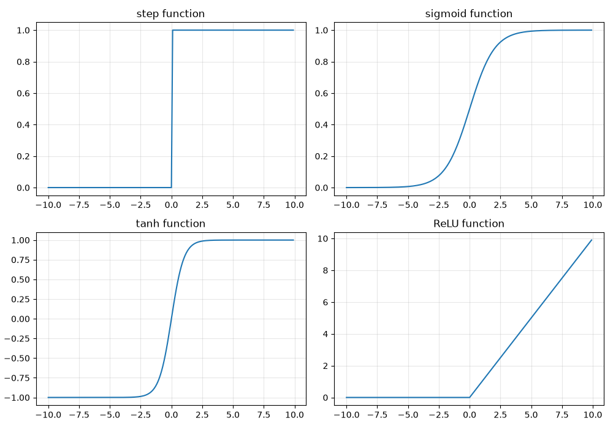
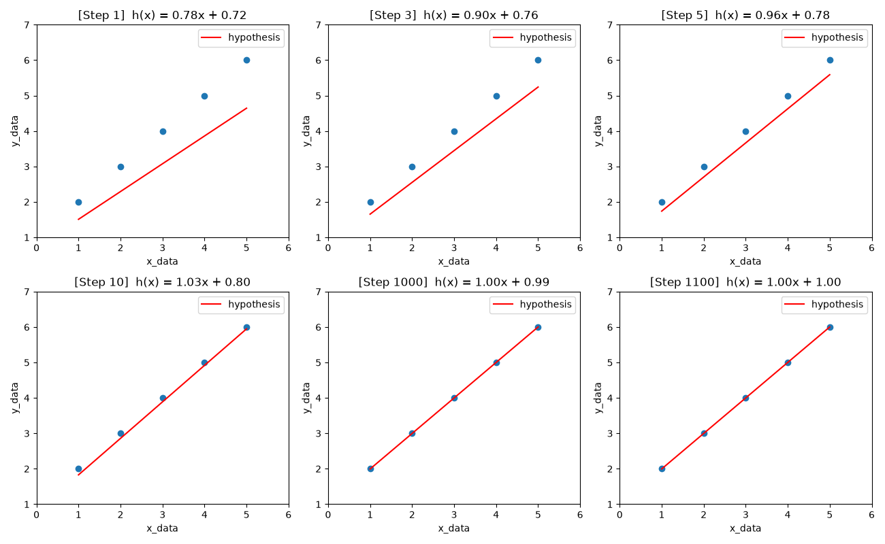
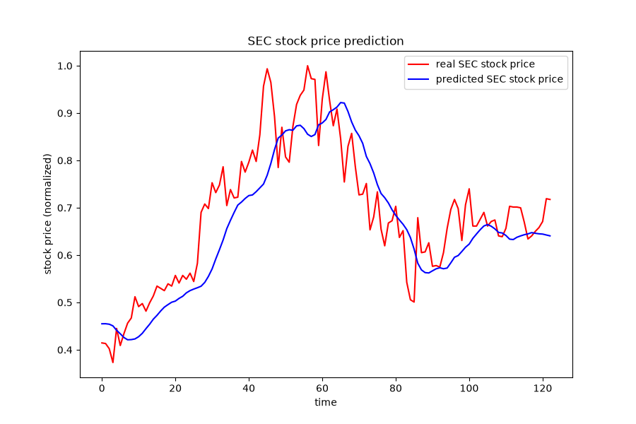

# ch9 — 딥러닝을 활용한 주가 예측

9장 실습 기록입니다. 활성화 함수와 다층 퍼셉트론으로 신경망의 기본 계산을
보고, 텐서플로로 선형 회귀를 학습시킨 뒤, LSTM으로 삼성전자의 다음 날
종가를 예측합니다.

## 파일 목록

```
ch9/
├── README.md
├── 9_1_activation_functions.py  # 활성화 함수 (계단, 시그모이드, tanh, ReLU, 소프트맥스)
├── 9_2_mlp.py                   # 다층 퍼셉트론의 순전파 계산
├── 9_3_linear_regression.py     # 텐서플로 선형 회귀 (경사 하강법)
├── 9_4_rnn_stock_prediction.py  # LSTM 주가 예측 (DB 필요)
└── images/                      # 실행하면 자동 저장되는 그래프
```

| 책 원본 ([Investar/StockAnalysisInPython](https://github.com/Investar/StockAnalysisInPython)의 `09_Deep_Learning_Prediction`) | 실습 파일 |
|---|---|
| `ch09_01` ~ `ch09_05` (활성화 함수 5개) | `9_1_activation_functions.py` (한 파일로 모음) |
| `ch09_06`, `ch09_07` (은닉층, 출력층) | `9_2_mlp.py` |
| `ch09_08_LinearRegression.py` | `9_3_linear_regression.py` |
| `ch09_09_RNN_StockPrediction.py` | `9_4_rnn_stock_prediction.py` |

## 준비

- `pip install tensorflow` (2.21.0 사용, 케라스 포함). 설치 전에
  `pip install --dry-run tensorflow`로 확인했을 때 numpy, pandas, protobuf
  버전은 바뀌지 않아서 `quant.venv`에 그대로 설치
- `9_4`는 MySQL이 켜져 있고 `INVESTAR` DB에 시세가 있어야 함

## 실행 방법

```
C:\workspaces\quant\quant.venv\Scripts\activate
cd C:\workspaces\quant\quant_실습\ch9
python 9_1_activation_functions.py
python 9_2_mlp.py
python 9_3_linear_regression.py
python 9_4_rnn_stock_prediction.py
```

그래프는 `images` 폴더에 자동 저장되고, 창을 닫으면 프로그램이 끝납니다.
텐서플로를 쓰는 `9_3`, `9_4`는 시작할 때 `oneDNN custom operations are on`
같은 안내 문구가 나오는데 오류가 아닙니다.

## 9_1_activation_functions.py — 활성화 함수

뉴런이 받은 입력을 "얼마나 세게 다음으로 전달할지" 정하는 함수입니다.



| 함수 | 모양 | 비고 |
|---|---|---|
| 계단 | 0 이하면 0, 넘으면 1 | 초기 퍼셉트론 |
| 시그모이드 | 0~1 사이의 S자 곡선 | `9_2`에서 사용 |
| tanh | -1~1 사이의 S자 곡선 | |
| ReLU | 0 이하면 0, 넘으면 입력값 그대로 | `9_4`에서 사용 |

소프트맥스는 여러 값을 합이 1인 확률로 바꿉니다. 실행 결과:

```
softmax 입력 : [0.3 2.9 4. ]
softmax 출력 : [0.0182 0.2452 0.7366]
출력의 합    : 1.0
```

책은 함수마다 파일과 그래프 창이 따로이고 소프트맥스는 함수 정의만
있어서, 네 그래프를 한 화면(2×2)에 모으고 소프트맥스 예시를 추가했습니다.

## 9_2_mlp.py — 다층 퍼셉트론

입력 2개 → 은닉층 뉴런 3개 → 출력 2개로 값이 전달되는 과정을 행렬 곱으로
직접 계산합니다. 층마다 "입력 × 가중치 + 편향"을 구하고(A) 시그모이드를
적용합니다(Z). 가중치와 편향은 책이 정해 준 값입니다.

실행 결과:

```
[은닉층]
A1 : [ 6. 13. 20.]
Z1 : [0.99752738 0.99999774 1.        ]
[출력층]
A2 : [0.69975229 1.69900982]
Y  : [0.66813285 0.84540537]
```

`A1`의 6 = 10×0.1 + 20×0.2 + 편향 1. 6, 13, 20은 시그모이드에 넣으면 모두
1에 가까워집니다.

## 9_3_linear_regression.py — 텐서플로 선형 회귀

점 (1,2) (2,3) (3,4) (4,5) (5,6)에 맞는 직선 `h(x) = w·x + b`를 찾습니다.
정답은 w=1, b=1이고, 일부러 w=0.7, b=0.7에서 출발합니다. `9_2`와 달리
가중치를 데이터로 학습시키는 예제입니다.

매 단계: 예측과 실제의 차이(`cost`, 평균 제곱 오차) 계산 →
`tf.GradientTape`로 `cost`가 줄어드는 방향 계산 → 학습률 0.01만큼 고침
(경사 하강법). 이를 1,100번 반복합니다.



실행 결과:

```
step|    w|    b| cost
----|-----|-----|-----
   1| 0.78| 0.72| 1.62
   3| 0.90| 0.76| 0.55
   5| 0.96| 0.78| 0.19
  10| 1.03| 0.80| 0.02
1000| 1.00| 0.99| 0.00
1100| 1.00| 1.00| 0.00
```

처음 10단계에 대부분 맞춰지고, 나머지는 미세하게 다듬는 데 쓰입니다. 책은
단계마다 그래프 창을 6번 띄우지만 한 화면(2×3)으로 모았습니다.

## 9_4_rnn_stock_prediction.py — LSTM 주가 예측

삼성전자의 최근 10일 시세(시가, 고가, 저가, 거래량, 종가)로 다음 날 종가를
예측합니다. LSTM은 순서가 있는 데이터를 하루씩 차례로 읽으며 앞의 내용을
기억해 판단에 반영하는 신경망입니다.

1. DB에서 2025-01-02 ~ 최신 날짜의 삼성전자 시세를 읽고, 모든 값을 0~1로
   정규화 (가격과 거래량의 크기 차이가 크기 때문)
2. "10일치 데이터 → 다음 날 종가" 묶음을 하루씩 밀어 가며 생성
3. 앞쪽 70%로 학습 (LSTM 2층 + 출력층, 가중치 1,491개, 60회 반복)
4. 뒤쪽 30%에서 실제 종가(빨강)와 예측 종가(파랑)를 비교
5. 가장 최근 10일로 다음 거래일 종가를 예측해 원 단위로 출력



실행 결과 (2026-11-17):

```
Epoch 60/60
10/10 ━━━━━━━━━━━━━━━━━━━━ 0s 5ms/step - loss: 0.0011
마지막 종가 (2026-09-22) : 274,500 KRW
다음 거래일 예측 종가 (Tomorrow's SEC price) : 250,349 KRW
```

### 결과를 볼 때 주의할 점

- 학습 오차(`loss`)가 0.001 수준으로 작아도 예측력이 있다는 뜻은 아님.
  이런 모델은 "내일은 오늘과 비슷하다"를 배우는 경우가 많아서, 예측선이
  실제선을 하루 늦게 따라가는 모양이 되기 쉬움
- 이번 예측(250,349원)은 마지막 종가(274,500원)보다 약 9% 낮음. 정규화가
  전체 기간의 최솟값과 최댓값 기준이라, 학습 구간보다 주가가 크게 오른
  최근 구간에서는 예측이 낮게 나오는 경향이 있음
- 이 예제는 딥러닝의 구조를 익히는 용도이며, 출력된 예측 종가는 투자
  판단에 쓸 수 있는 값이 아님
- 위 실행 때 DB의 마지막 날짜가 2026-09-22였음. MySQL이 꺼져 있던 동안 시세
  업데이트가 멈춘 것으로, 예측은 그 날짜의 다음 거래일에 대한 것. 이후
  `Investar\DBUpdaterEx.py`로 2026-11-17까지 DB를 채웠으므로, 다시 실행하면
  최신 날짜 기준으로 예측함

### 책 원본 대비 수정 사항

- 조회 기간: 책은 2018-05-04 ~ 2020-01-22, DB에 그 기간이 없어서 최근 기간 사용
- `LSTM(..., input_shape=...)` 대신 `Input` 층 사용 (케라스 3 권장 방식)
- `raw_df.close[-1]` 대신 `.iloc[-1]` (최신 pandas는 위치 인덱싱에 `iloc` 필요)
- 예측 가격 환산: 책은 비례식(`raw_df.close[-1] * pred_y[-1] / dfy.close[-1]`)을
  쓰지만, 정규화가 "최솟값을 빼고 범위로 나눈 것"이라 비례식은 정확하지
  않음. 정규화의 역변환으로 계산
- `tf.keras.utils.set_random_seed(42)`로 실행할 때마다 결과가 같게 함
